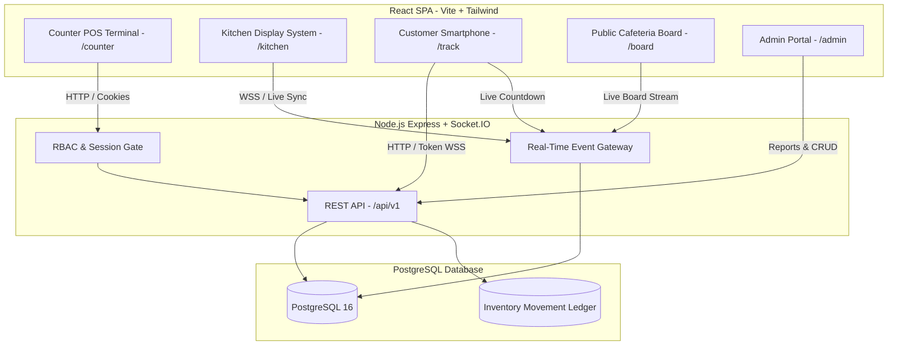

# CampusBite — Mobile-First Restaurant POS & Kitchen Management System

> A reliable, secure, zero-budget restaurant order management platform designed for college cafeterias and high-volume quick-service restaurants.

[](https://github.com/Vaibhav-1430/campusbite/actions)


---

## Architecture Overview



---

## Key Features

1. **Role-Based Portals**:
   - `ADMIN`: Menu items, categories, staff provisioning, inventory ledger, business analytics, and CSV exports.
   - `COUNTER`: High-speed touch POS terminal, cart calculation in integer paise, token printing (`CB-101`), and order handover.
   - `KITCHEN`: Real-time order claiming, countdown preparation timers, time extensions (+5m/+10m), and Web Audio alerts.
2. **Customer Self-Service**:
   - Permanent Universal QR code linking to `/track`.
   - Secure order lookup using daily token number and 4-digit PIN.
   - Live preparation countdowns that persist across device sleep and network reconnects.
3. **Public TV Board (`/board`)**:
   - Privacy-sanitized live queue for large cafeteria screens showing "Preparing" and "Ready for Pickup" tickets.
4. **Inventory & Spoilage Ledger**:
   - Immutable stock movement tracking (`MANUAL_RESTOCK`, `MANUAL_ADJUSTMENT`, `ORDER_DEDUCTION`, `CANCELLATION_RESTORE`).
   - Atomic deduction at checkout and automatic restoration on ticket cancellation.
5. **Business Analytics & Daily Closing**:
   - Sales trends, item rankings, kitchen turnaround speed, stock threshold alerts, and idempotent daily closing register.
   - Standard RFC 4180 CSV report downloads.

---

## Monorepo Structure

```
campusbite/
├── apps/
│   ├── api/             # Express.js REST API, Prisma ORM, Socket.IO gateway
│   └── web/             # React 18, Vite, TailwindCSS, Lucide icons
├── packages/
│   └── shared/          # Shared TypeScript DTOs, Zod schemas, CSV utilities
├── docs/                # Architecture, API design, security, and runbooks
└── .github/workflows/   # Automated CI testing and build verification
```

---

## Quick Start (Local Development)

### 1. Prerequisites
- **Node.js**: v20.x or higher
- **PostgreSQL**: v15 or higher (running locally on port `5432`)
- **Git**

### 2. Installation
```bash
# Clone the repository
git clone https://github.com/Vaibhav-1430/campusbite.git
cd campusbite

# Install all monorepo dependencies
npm install
```

### 3. Database & Environment Configuration
```bash
# Create local database in PostgreSQL
psql -U postgres -c "CREATE DATABASE campusbite_dev;"

# Setup API environment variables
cp apps/api/.env.example apps/api/.env
```

### 4. Apply Migrations & Seed Initial Admin
```bash
# Run migrations on local database
npm run db:migrate

# Bootstrap root administrator
npm run db:seed:admin
```
*(Default development credentials: `admin@campusbite.internal` / `AdminPassword123!`)*

### 5. Launch Development Servers
```bash
# Concurrently start API (:5000) and Web (:5173)
npm run dev
```
Open **[http://localhost:5173](http://localhost:5173)** in your browser.

---

## Testing & Production Verification

CampusBite includes a comprehensive automated test suite (160 tests across 20 suites):

```bash
# Run all monorepo test suites
npm test

# Run TypeScript typechecks and production bundle build
npm run build
```

---

## Production Deployment (₹0 Budget)

CampusBite is pre-configured for free-tier cloud deployment:
- **Frontend SPA**: [Vercel](https://vercel.com) or [Cloudflare Pages](https://pages.cloudflare.com)
- **Backend API**: [Render.com](https://render.com) Web Service
- **Managed PostgreSQL**: [Neon.tech](https://neon.tech) Serverless Postgres

For full deployment instructions, see the **[Zero-Budget Launch Runbook](docs/launch-runbook.md)**.

---

## Documentation & Operational Runbooks

- [Production Readiness Checklist](docs/production-readiness-checklist.md)
- [Security Review & Threat Model](docs/security-review.md)
- [Zero-Budget Deployment Matrix](docs/deployment.md)
- [Environment Variables Catalog](docs/environment-variables.md)
- [Database Backup & Disaster Recovery](docs/database-backup-and-recovery.md)
- [Monitoring & Troubleshooting Guide](docs/monitoring-and-troubleshooting.md)
- [REST API & WebSocket Specifications](docs/api-design.md)
- [Database Schema & ERD](docs/database-design.md)
