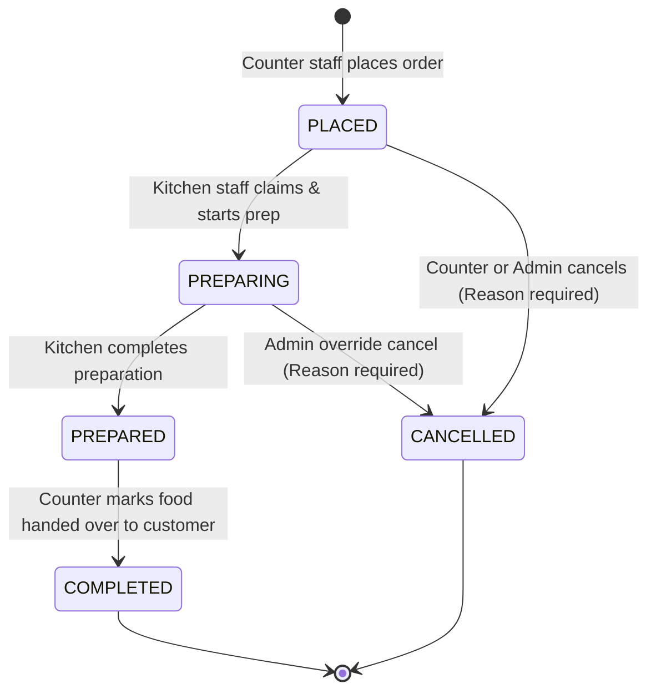

# CampusBite — System Architecture

## 1. Architectural Philosophy & Overview

CampusBite is engineered as a **Modular Monolith** in a clean, typed monorepo. It prioritizes:
- **Simplicity & Maintainability**: Single codebase with shared TypeScript definitions eliminating schema duplication and serialization errors.
- **Strict Data Integrity**: PostgreSQL as the single source of truth using serializable or read-committed transactions for orders, stock deductions, and status changes.
- **Real-Time Responsiveness**: WebSocket event streams (Socket.IO) overlaid on persistent database operations for sub-second UI synchronization across Counter, Kitchen, and Customer screens.
- **Zero-Dollar (₹0) Cost Profile**: Designed to run efficiently within free compute and database tier limits (e.g., Render/Railway free tier for API, Neon serverless PostgreSQL, Vercel for SPA frontend).

```
                        +------------------------------------+
                        |         React Client (SPA)         |
                        |      (Vite + Tailwind + shadcn)     |
                        |  Routes: Admin, Counter, KDS, Track|
                        +-----------------+------------------+
                                          |
                        HTTPS (REST API)  |  WSS (Socket.IO Events)
                                          |
                        +-----------------v------------------+
                        |        Node.js / Express API       |
                        |   (Modular Monolith in TypeScript) |
                        +-----------------+------------------+
                                          |
                                          | Prisma ORM (Connection Pool)
                                          v
                        +------------------------------------+
                        |         PostgreSQL Database        |
                        | (Neon / Supabase / Local 18.x)     |
                        +------------------------------------+
```

---

## 2. Monorepo Organization

The project employs a clean monorepo managed with `npm workspaces` (or `pnpm`), preventing circular dependencies and isolating concerns:

```
campusbite/
├── apps/
│   ├── web/                     # Frontend Application (React + Vite + Tailwind + shadcn)
│   │   ├── src/
│   │   │   ├── assets/          # Static audio, logos, icons
│   │   │   ├── components/      # UI components (shadcn primitives & custom domain widgets)
│   │   │   ├── hooks/           # useAuth, useSocket, useOrderTimer, useAudioAlert
│   │   │   ├── layouts/         # AdminLayout, StaffLayout, CustomerLayout
│   │   │   ├── pages/           # AdminDashboard, CounterPOS, KitchenKDS, CustomerTrack, Login
│   │   │   ├── services/        # Axios/Fetch API clients & Socket.IO listeners
│   │   │   └── types/           # Client-specific UI state models
│   │   ├── index.html
│   │   ├── vite.config.ts
│   │   └── package.json
│   │
│   └── api/                     # Backend Application (Node.js + Express + Socket.IO)
│       ├── src/
│       │   ├── config/          # Env parsing, logger, constants
│       │   ├── database/        # Prisma client instance & extensions
│       │   ├── middleware/      # Auth (JWT), RBAC, rate-limiting, error handler
│       │   ├── modules/         # Domain-Driven feature modules
│       │   │   ├── auth/        # Login, logout, password reset, bootstrap
│       │   │   ├── users/       # Staff CRUD, activate/deactivate
│       │   │   ├── menu/        # Categories, items, prices, availability
│       │   │   ├── orders/      # POS cart checkout, daily numbering, status machine
│       │   │   ├── kitchen/     # Claiming, preparation start, time adjustments, ready
│       │   │   ├── tracking/    # Public customer tracking endpoints
│       │   │   ├── inventory/   # Stock levels, movements, low-stock triggers
│       │   │   ├── analytics/   # Daily/monthly revenue, prep-time metrics, closing report
│       │   │   ├── audit/       # Operational audit trail recorder
│       │   │   └── events/      # Socket.IO emitter handlers, rooms, auth
│       │   ├── server.ts        # Express setup, HTTP server, Socket.IO binding
│       │   └── index.ts         # Process entrypoint & graceful shutdown
│       ├── prisma/
│       │   ├── schema.prisma    # Complete PostgreSQL schema
│       │   ├── migrations/      # Version-controlled SQL migrations
│       │   └── seed.ts          # First-admin bootstrap & sample data
│       └── package.json
│
├── packages/
│   └── shared/                  # Zero-dependency shared package
│       ├── src/
│       │   ├── constants/       # Order status enums, role enums, time defaults
│       │   ├── schemas/         # Zod schemas (login, order creation, adjustments)
│       │   └── types/           # TypeScript interfaces & Socket.IO event contracts
│       ├── package.json
│       └── tsconfig.json
│
├── docs/                        # Architecture & engineering specifications
├── package.json                 # Monorepo root scripts (build, dev, test)
└── README.md
```

---

## 3. Core Subsystems & Boundaries

### 3.1 Authentication & Authorization Subsystem
* **Token Strategy**: HTTP-only, secure, SameSite cookies carrying signed JWTs with short expiry (e.g., 8 hours for shift workers).
* **Role Verification Middleware**:
  ```typescript
  export const requireRole = (allowedRoles: Role[]) => {
    return (req: Request, res: Response, next: NextFunction) => {
      if (!req.user || !allowedRoles.includes(req.user.role)) {
        return res.status(403).json({ error: 'FORBIDDEN', message: 'Insufficient role permissions' });
      }
      next();
    };
  };
  ```
* **Deactivation Shield**: Active JWT contains user ID and token version; whenever an account is deactivated or password changed, the user's `tokenVersion` in PostgreSQL is incremented, immediately invalidating active sessions.

### 3.2 Order Lifecycle & State Machine
The order follows a strict, non-skippable state machine governed entirely on the backend:



* **Transition Enforcement**: The backend verifies `currentStatus` before permitting an update. Any illegal transition (e.g. `PLACED` → `COMPLETED` directly) throws a `409 Conflict` domain error.
* **Status History Table**: Every state change records `previousStatus`, `newStatus`, `changedByUserId`, `reason`, and `timestamp` in `OrderStatusHistory`.

### 3.3 Preparation Time Engine
* **Initial Calculation**:
  $$\text{initialEstimateMinutes} = \max_{i \in \text{Items}} (\text{item}_i.\text{prepTimeMinutes})$$
  *(If items have unspecified or 0 prep time, default fallback is 10 minutes).*
* **Countdown Start**:
  Preparation timer does **not** begin when the order is placed. It begins strictly when kitchen staff triggers `START_PREPARATION`.
  ```typescript
  estimated_completion_at = new Date(Date.now() + initialEstimateMinutes * 60 * 1000);
  ```
* **Dynamic Time Extensions**:
  Kitchen staff can submit `+1`, `+3`, `+5`, or `custom` minutes via `/api/v1/kitchen/orders/:id/adjust-time`.
  * The server computes: `newEstimatedCompletion = currentEstimatedCompletion + (addedMinutes * 60 * 1000)`.
  * Persists the adjustment in `PreparationTimeAdjustment` record.
  * Emits `ORDER_TIME_ADJUSTED` event to all clients tracking that order.
* **Resynchronization Guarantee**:
  Clients do not run standalone unanchored timers. They calculate remaining time as:
  $$\text{remainingSeconds} = \max\left(0, \left\lfloor\frac{\text{estimatedCompletionAt} - \text{serverCurrentTime}}{1000}\right\rfloor\right)$$
  When a browser tab re-opens or mobile wakes up, it re-queries the API or receives a sync ping, recalculating the exact remaining seconds instantly.

---

## 4. Concurrency & Atomic Operations

### 4.1 Safe Atomic Order Claiming
In a busy kitchen, two cooks may simultaneously tap "Claim Order" on the same unassigned ticket. To prevent dual-assignment:
```sql
-- Atomic conditional update
UPDATE "Order"
SET 
  "assignedToId" = $kitchenStaffUserId,
  "status" = 'PREPARING',
  "preparationStartedAt" = NOW(),
  "estimatedCompletionAt" = NOW() + ("initialEstimatedMinutes" * INTERVAL '1 minute'),
  "updatedAt" = NOW()
WHERE "id" = $orderId
  AND "assignedToId" IS NULL
  AND "status" = 'PLACED'
RETURNING *;
```
If the query returns zero updated rows, another cook successfully claimed the order a millisecond earlier. The server returns a `409 Conflict` with message `"Order has already been claimed"`, and the UI refreshes gracefully.

### 4.2 Atomic Inventory Deduction & Overselling Prevention
When placing an order with stock-tracked items:
```typescript
await prisma.$transaction(async (tx) => {
  for (const item of orderItems) {
    if (item.stockItemId) {
      const stock = await tx.stockItem.update({
        where: { id: item.stockItemId },
        data: {
          currentQuantity: { decrement: item.quantity }
        }
      });
      if (stock.currentQuantity < 0) {
        throw new Error(`Insufficient stock for item: ${item.name}`);
      }
      await tx.inventoryMovement.create({
        data: {
          stockItemId: item.stockItemId,
          quantityChange: -item.quantity,
          type: 'ORDER_DEDUCTION',
          orderId: order.id,
          performedById: staffUserId
        }
      });
    }
  }
  // Create Order and OrderItems...
});
```

### 4.3 Idempotency on Order Creation
Network lag or double-tapping on mobile touchscreens can cause duplicate orders.
* Frontend generates an `idempotencyKey = uuidv4()` before sending `POST /api/v1/orders`.
* Database enforces a unique constraint on `idempotencyKey`.
* If a duplicate request arrives, the server retrieves and returns the previously created order rather than creating a duplicate.

---

## 5. Real-Time Communication Architecture (Socket.IO)

### 5.1 Rooms & Security Boundaries
Socket.IO is organized into authenticated rooms to prevent data leakage:
* `staff:admin`: Receives all operational events, stock alerts, cancellation logs, and revenue metrics.
* `staff:counter`: Receives order status updates, kitchen ready notifications, and inventory alerts.
* `staff:kitchen`: Receives new order arrivals (triggers audio bell), assignment changes, and cancellations.
* `order:<orderId>`: Public customer room. A customer client can join this room **only** after providing valid `orderNumber` and `verificationPin`. Only status and time adjustment events are broadcast here.

### 5.2 Real-Time Event Catalog

| Event Name | Emitter | Target Room(s) | Payload Summary |
|---|---|---|---|
| `ORDER_CREATED` | Server (Orders API) | `staff:kitchen`, `staff:counter`, `staff:admin` | Full order ticket, items, prep estimate, daily order # |
| `ORDER_CLAIMED` | Server (Kitchen API) | `staff:kitchen`, `staff:counter`, `staff:admin` | Order ID, assigned kitchen staff name, timestamp |
| `ORDER_PREP_STARTED` | Server (Kitchen API) | `staff:*`, `order:<id>` | Order ID, preparationStartedAt, estimatedCompletionAt |
| `ORDER_TIME_ADJUSTED`| Server (Kitchen API) | `staff:*`, `order:<id>` | Order ID, addedMinutes, newEstimatedCompletionAt |
| `ORDER_PREPARED` | Server (Kitchen API) | `staff:counter`, `staff:admin`, `order:<id>` | Order ID, readyAt, collectionPrompt |
| `ORDER_COMPLETED` | Server (Counter API) | `staff:admin`, `order:<id>` | Order ID, completedAt |
| `ORDER_CANCELLED` | Server (Orders API) | `staff:*`, `order:<id>` | Order ID, reason, cancelledBy |
| `STOCK_LOW_ALERT` | Server (Inventory) | `staff:admin`, `staff:counter` | Stock item ID, item name, currentQty, threshold |

### 5.3 Single-Instance Deployment Considerations (₹0 Free Tier)
On free-tier hosting (e.g. Render/Railway free plan), the API runs as a **single Node.js instance**.
* A single Node.js process handles WebSockets directly in-memory without requiring a paid Redis instance for Pub/Sub.
* In the future, if horizontally scaling across multiple instances, a Redis adapter (`@socket.io/redis-adapter`) can be plugged in transparently.
* For the initial release, in-memory Socket.IO running alongside Express is zero-cost, blazing fast (<5ms inter-room dispatch), and completely reliable.

---

## 6. Currency & Number Handling

* **Zero Floating-Point Errors**: All currency values in database, APIs, and calculations are stored as **integer paise** (e.g. ₹120.50 = `12050`).
* **Frontend Display Formatter**:
  ```typescript
  export const formatPaise = (paise: number): string => {
    return new Intl.NumberFormat('en-IN', {
      style: 'currency',
      currency: 'INR',
      maximumFractionDigits: 0
    }).format(paise / 100);
  };
  ```
