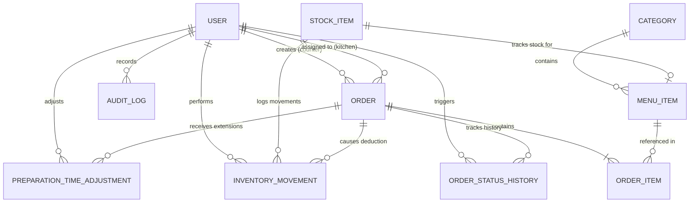

# CampusBite — Database Design Specification

## 1. Overview & Principles

CampusBite uses **PostgreSQL** managed through **Prisma ORM**. Key database design principles include:
1. **Financial Integrity**: All currency values stored as 64-bit BigInt / 32-bit Integer **Paise** (1 Rupee = 100 paise) to prevent floating-point calculation errors.
2. **Historical Immutability**: Order line items capture full snapshots of item names, unit prices, and estimated preparation times at the moment of sale. Future menu price updates do not retroactively alter sales figures.
3. **Atomic State Transitions**: Status changes, assignment claiming, and inventory alterations are bound inside strict ACID database transactions with row-level locks or conditional updates.
4. **Auditability**: Dedicated `OrderStatusHistory`, `InventoryMovement`, and `AuditLog` tables create a tamper-evident operational record.

---

## 2. Entity Relationship Diagram (ERD)



---

## 3. Detailed Table Schemas

### 3.1 Users (`User`)
Stores staff accounts. Created exclusively by administrators; no public registration.

| Column | Type | Constraints | Description |
|---|---|---|---|
| `id` | UUID | PRIMARY KEY, DEFAULT gen_random_uuid() | Unique identifier |
| `email` | VARCHAR(255) | UNIQUE, NOT NULL | Staff login email (normalized lowercase) |
| `passwordHash` | VARCHAR(255) | NOT NULL | Salted bcrypt or argon2 hash |
| `name` | VARCHAR(100) | NOT NULL | Full name of staff member |
| `role` | ENUM | NOT NULL | `ADMIN`, `COUNTER`, `KITCHEN` |
| `isActive` | BOOLEAN | DEFAULT true, NOT NULL | Account active flag (deactivated cannot login) |
| `tokenVersion`| INTEGER | DEFAULT 1, NOT NULL | Incremented on password reset to kill sessions |
| `createdAt` | TIMESTAMPTZ | DEFAULT NOW(), NOT NULL | Account creation timestamp |
| `updatedAt` | TIMESTAMPTZ | DEFAULT NOW(), NOT NULL | Last update timestamp |

*Indexes:*
- `idx_users_email` ON (`email`)
- `idx_users_role_is_active` ON (`role`, `isActive`)

---

### 3.2 Categories (`Category`)
Organizes menu items for fast touch-based filtering on counter POS.

| Column | Type | Constraints | Description |
|---|---|---|---|
| `id` | UUID | PRIMARY KEY, DEFAULT gen_random_uuid() | Unique identifier |
| `name` | VARCHAR(100) | UNIQUE, NOT NULL | Category name (e.g., "Beverages", "Burgers") |
| `displayOrder`| INTEGER | DEFAULT 0, NOT NULL | UI display order |
| `isActive` | BOOLEAN | DEFAULT true, NOT NULL | Visible on active menu |
| `createdAt` | TIMESTAMPTZ | DEFAULT NOW(), NOT NULL | Creation timestamp |
| `updatedAt` | TIMESTAMPTZ | DEFAULT NOW(), NOT NULL | Update timestamp |

---

### 3.3 Menu Items (`MenuItem`)
Food and beverage offerings.

| Column | Type | Constraints | Description |
|---|---|---|---|
| `id` | UUID | PRIMARY KEY, DEFAULT gen_random_uuid() | Unique identifier |
| `categoryId` | UUID | NOT NULL, REFERENCES Category(id) | Associated category |
| `name` | VARCHAR(150) | NOT NULL | Item name (e.g., "Veg Grilled Sandwich") |
| `description` | TEXT | NULL | Ingredients, allergens, description |
| `pricePaise` | INTEGER | NOT NULL, CHECK (pricePaise >= 0) | Price in paise (e.g., ₹80.00 = 8000) |
| `prepTimeMinutes`| INTEGER | DEFAULT 10, NOT NULL, CHECK (prepTimeMinutes > 0) | Standard preparation time |
| `imageUrl` | VARCHAR(500) | NULL | Optional image URL |
| `isAvailable` | BOOLEAN | DEFAULT true, NOT NULL | Manual out-of-stock toggle |
| `stockItemId`| UUID | NULL, REFERENCES StockItem(id) | Optional link to physical stock inventory |
| `createdAt` | TIMESTAMPTZ | DEFAULT NOW(), NOT NULL | Creation timestamp |
| `updatedAt` | TIMESTAMPTZ | DEFAULT NOW(), NOT NULL | Update timestamp |

*Indexes:*
- `idx_menu_category_available` ON (`categoryId`, `isAvailable`)

---

### 3.4 Stock Items (`StockItem`)
Manages unit-level raw or packaged inventory to prevent overselling.

| Column | Type | Constraints | Description |
|---|---|---|---|
| `id` | UUID | PRIMARY KEY, DEFAULT gen_random_uuid() | Unique identifier |
| `name` | VARCHAR(150) | UNIQUE, NOT NULL | Inventory item name (e.g., "Cold Coffee Bottle")|
| `unit` | VARCHAR(50) | NOT NULL | Unit of measure (e.g., "pcs", "cans", "portions")|
| `currentQuantity`| INTEGER | DEFAULT 0, NOT NULL, CHECK (currentQuantity >= 0) | Current stock on hand |
| `lowStockThreshold`| INTEGER | DEFAULT 10, NOT NULL | Threshold to trigger low-stock warning |
| `createdAt` | TIMESTAMPTZ | DEFAULT NOW(), NOT NULL | Creation timestamp |
| `updatedAt` | TIMESTAMPTZ | DEFAULT NOW(), NOT NULL | Update timestamp |

---

### 3.5 Inventory Movements (`InventoryMovement`)
Immutable ledger of all inventory additions, subtractions, and restorations.

| Column | Type | Constraints | Description |
|---|---|---|---|
| `id` | UUID | PRIMARY KEY, DEFAULT gen_random_uuid() | Unique identifier |
| `stockItemId`| UUID | NOT NULL, REFERENCES StockItem(id) | Affected stock item |
| `quantityChange`| INTEGER | NOT NULL | Positive for restock/restoration, negative for deduction |
| `previousQuantity`| INTEGER | NULL | Stock balance immediately prior to movement |
| `newQuantity`| INTEGER | NULL | Stock balance immediately following movement |
| `type` | ENUM | NOT NULL | `ORDER_DEDUCTION`, `CANCELLATION_RESTORE`, `MANUAL_RESTOCK`, `MANUAL_ADJUSTMENT` |
| `orderId` | UUID | NULL, REFERENCES Order(id) | Linked order if caused by sale/cancel |
| `performedById`| UUID | NOT NULL, REFERENCES User(id) | Staff member who triggered movement |
| `note` | TEXT | NULL | Reason or invoice notes |
| `createdAt` | TIMESTAMPTZ | DEFAULT NOW(), NOT NULL | Timestamp of ledger entry |

*Indexes:*
- `idx_inventory_movement_stock_created` ON (`stockItemId`, `createdAt`)

---

### 3.6 Orders (`Order`)
Central operational entity representing a dining ticket.

| Column | Type | Constraints | Description |
|---|---|---|---|
| `id` | UUID | PRIMARY KEY, DEFAULT gen_random_uuid() | Internal primary key |
| `dailyOrderNumber`| VARCHAR(20) | NOT NULL | Human-readable daily sequence (e.g. "CB-101") |
| `orderDate` | DATE | DEFAULT CURRENT_DATE, NOT NULL | Date used for daily sequence uniqueness |
| `idempotencyKey`| VARCHAR(100) | UNIQUE, NOT NULL | Client-submitted UUID preventing duplicate checkout |
| `status` | ENUM | NOT NULL, DEFAULT 'PLACED' | `PLACED`, `PREPARING`, `PREPARED`, `COMPLETED`, `CANCELLED` |
| `totalPaise` | INTEGER | NOT NULL, CHECK (totalPaise >= 0) | Sum of item totals in paise |
| `customerPinHash`| VARCHAR(255) | NOT NULL | Salted hash of 4-digit customer tracking PIN |
| `initialEstimatedMinutes` | INTEGER | NOT NULL | Max prep time of ordered items at placement |
| `preparationStartedAt` | TIMESTAMPTZ | NULL | Exact server timestamp when KDS started prep |
| `estimatedCompletionAt` | TIMESTAMPTZ | NULL | Dynamic authoritative completion timestamp |
| `preparedAt` | TIMESTAMPTZ | NULL | Timestamp when kitchen marked PREPARED |
| `completedAt` | TIMESTAMPTZ | NULL | Timestamp when counter marked HANDED OVER |
| `cancelledAt` | TIMESTAMPTZ | NULL | Timestamp if cancelled |
| `cancellationReason` | TEXT | NULL | Required if cancelled |
| `createdById` | UUID | NOT NULL, REFERENCES User(id) | Counter staff who entered order |
| `assignedToId`| UUID | NULL, REFERENCES User(id) | Kitchen staff who claimed order |
| `createdAt` | TIMESTAMPTZ | DEFAULT NOW(), NOT NULL | Placement timestamp |
| `updatedAt` | TIMESTAMPTZ | DEFAULT NOW(), NOT NULL | Last update timestamp |

*Indexes & Unique Constraints:*
- UNIQUE (`orderDate`, `dailyOrderNumber`) — Guarantees no duplicate order numbers on same day
- `idx_orders_status_created` ON (`status`, `createdAt` DESC)
- `idx_orders_assigned_status` ON (`assignedToId`, `status`)
- `idx_orders_idempotency` ON (`idempotencyKey`)

---

### 3.7 Order Items (`OrderItem`)
Snapshots of purchased food items.

| Column | Type | Constraints | Description |
|---|---|---|---|
| `id` | UUID | PRIMARY KEY, DEFAULT gen_random_uuid() | Unique identifier |
| `orderId` | UUID | NOT NULL, REFERENCES Order(id) ON DELETE CASCADE | Parent order |
| `menuItemId` | UUID | NOT NULL, REFERENCES MenuItem(id) | Original menu item reference |
| `nameSnapshot`| VARCHAR(150) | NOT NULL | Name at time of sale |
| `unitPricePaiseSnapshot`| INTEGER | NOT NULL | Unit price in paise at time of sale |
| `prepTimeMinutesSnapshot`| INTEGER| NOT NULL | Item prep time at time of sale |
| `quantity` | INTEGER | NOT NULL, CHECK (quantity > 0) | Number of portions ordered |
| `subtotalPaise` | INTEGER | NOT NULL | `quantity * unitPricePaiseSnapshot` |
| `notes` | VARCHAR(255) | NULL | Customer customization notes (e.g. "Less spicy") |

---

### 3.8 Order Status History (`OrderStatusHistory`)
Immutable audit trail tracking state progression.

| Column | Type | Constraints | Description |
|---|---|---|---|
| `id` | UUID | PRIMARY KEY, DEFAULT gen_random_uuid() | Unique identifier |
| `orderId` | UUID | NOT NULL, REFERENCES Order(id) ON DELETE CASCADE | Associated order |
| `previousStatus`| ENUM | NULL | Previous state (null on initial creation) |
| `newStatus` | ENUM | NOT NULL | Destination state |
| `changedById`| UUID | NOT NULL, REFERENCES User(id) | Staff member who triggered state change |
| `reason` | TEXT | NULL | Explanation (mandatory for CANCELLED) |
| `timestamp` | TIMESTAMPTZ | DEFAULT NOW(), NOT NULL | Exact time of state change |

---

### 3.9 Preparation Time Adjustments (`PreparationTimeAdjustment`)
Records kitchen time additions (+1, +3, +5, custom minutes).

| Column | Type | Constraints | Description |
|---|---|---|---|
| `id` | UUID | PRIMARY KEY, DEFAULT gen_random_uuid() | Unique identifier |
| `orderId` | UUID | NOT NULL, REFERENCES Order(id) ON DELETE CASCADE | Target order |
| `staffId` | UUID | NOT NULL, REFERENCES User(id) | Kitchen cook who added time |
| `minutesAdded`| INTEGER | NOT NULL, CHECK (minutesAdded > 0) | Minutes added |
| `previousEstimatedCompletionAt`| TIMESTAMPTZ | NOT NULL | Completion timestamp before extension |
| `newEstimatedCompletionAt` | TIMESTAMPTZ | NOT NULL | New completion timestamp after extension |
| `reason` | VARCHAR(255) | NULL | Optional kitchen reason (e.g., "Deep fryer delay")|
| `createdAt` | TIMESTAMPTZ | DEFAULT NOW(), NOT NULL | Time of extension |

---

### 3.10 Operational Audit Logs (`AuditLog`)
Tracks administrative and critical changes.

| Column | Type | Constraints | Description |
|---|---|---|---|
| `id` | UUID | PRIMARY KEY, DEFAULT gen_random_uuid() | Unique identifier |
| `actorId` | UUID | NOT NULL, REFERENCES User(id) | Staff member who acted |
| `actorRole` | ENUM | NOT NULL | Role at time of action |
| `action` | VARCHAR(100) | NOT NULL | E.g. `USER_CREATED`, `PRICE_UPDATED`, `STOCK_RESTOCKED`|
| `entityType` | VARCHAR(50) | NOT NULL | E.g. `User`, `MenuItem`, `StockItem` |
| `entityId` | VARCHAR(100) | NOT NULL | ID of modified entity |
| `metadataJson`| JSONB | NULL | Before/after state or details (no secrets) |
| `ipAddress` | VARCHAR(45) | NULL | Originating client IP |
| `createdAt` | TIMESTAMPTZ | DEFAULT NOW(), NOT NULL | Timestamp |

---

### 3.12 Daily Order Sequence (`DailyOrderSequence`)
Maintains atomic, collision-safe sequence counters per calendar date for order numbers (`CB-101`, `CB-102`...).

| Column | Type | Constraints | Description |
|---|---|---|---|
| `id` | UUID | PRIMARY KEY, DEFAULT gen_random_uuid() | Unique identifier |
| `orderDate` | DATE | UNIQUE, NOT NULL | Calendar date in restaurant-local timezone |
| `lastSequence` | INTEGER | NOT NULL, DEFAULT 100 | Last assigned daily order sequence number |
| `createdAt` | TIMESTAMPTZ | DEFAULT NOW(), NOT NULL | Timestamp |
| `updatedAt` | TIMESTAMPTZ | DEFAULT NOW(), NOT NULL | Timestamp |

---

## 4. Prisma Schema Representation

```prisma
datasource db {
  provider = "postgresql"
  url      = env("DATABASE_URL")
}

generator client {
  provider = "prisma-client-js"
}

enum Role {
  ADMIN
  COUNTER
  KITCHEN
}

enum OrderStatus {
  PLACED
  PREPARING
  PREPARED
  COMPLETED
  CANCELLED
}

enum InventoryMovementType {
  ORDER_DEDUCTION
  CANCELLATION_RESTORE
  MANUAL_RESTOCK
  MANUAL_ADJUSTMENT
}

model User {
  id                      String                     @id @default(uuid())
  email                   String                     @unique
  passwordHash            String
  name                    String
  role                    Role
  isActive                Boolean                    @default(true)
  tokenVersion            Int                        @default(1)
  createdAt               DateTime                   @default(now())
  updatedAt               DateTime                   @updatedAt
  createdOrders           Order[]                    @relation("CreatedBy")
  assignedOrders          Order[]                    @relation("AssignedTo")
  statusHistoryEntries    OrderStatusHistory[]
  prepAdjustments         PreparationTimeAdjustment[]
  inventoryMovements      InventoryMovement[]
  auditLogs               AuditLog[]
}

model Category {
  id           String     @id @default(uuid())
  name         String     @unique
  displayOrder Int        @default(0)
  isActive     Boolean    @default(true)
  createdAt    DateTime   @default(now())
  updatedAt    DateTime   @updatedAt
  menuItems    MenuItem[]
}

model MenuItem {
  id              String      @id @default(uuid())
  categoryId      String
  category        Category    @relation(fields: [categoryId], references: [id])
  name            String
  description     String?
  pricePaise      Int
  prepTimeMinutes Int         @default(10)
  imageUrl        String?
  isAvailable     Boolean     @default(true)
  stockItemId     String?
  stockItem       StockItem?  @relation(fields: [stockItemId], references: [id])
  createdAt       DateTime    @default(now())
  updatedAt       DateTime    @updatedAt
  orderItems      OrderItem[]

  @@index([categoryId, isAvailable])
}

model StockItem {
  id                 String              @id @default(uuid())
  name               String              @unique
  unit               String
  currentQuantity    Int                 @default(0)
  lowStockThreshold  Int                 @default(10)
  createdAt          DateTime            @default(now())
  updatedAt          DateTime            @updatedAt
  menuItems          MenuItem[]
  inventoryMovements InventoryMovement[]
}

model InventoryMovement {
  id             String                @id @default(uuid())
  stockItemId    String
  stockItem      StockItem             @relation(fields: [stockItemId], references: [id])
  quantityChange Int
  type           InventoryMovementType
  orderId        String?
  order          Order?                @relation(fields: [orderId], references: [id])
  performedById  String
  performedBy    User                  @relation(fields: [performedById], references: [id])
  note           String?
  createdAt      DateTime              @default(now())
}

model Order {
  id                       String                      @id @default(uuid())
  dailyOrderNumber         String
  orderDate                DateTime                    @default(now()) @db.Date
  idempotencyKey           String                      @unique
  status                   OrderStatus                 @default(PLACED)
  totalPaise               Int
  customerPinHash          String
  initialEstimatedMinutes  Int
  preparationStartedAt     DateTime?
  estimatedCompletionAt    DateTime?
  preparedAt               DateTime?
  completedAt              DateTime?
  cancelledAt              DateTime?
  cancellationReason       String?
  createdById              String
  createdBy                User                        @relation("CreatedBy", fields: [createdById], references: [id])
  assignedToId             String?
  assignedTo               User?                       @relation("AssignedTo", fields: [assignedToId], references: [id])
  createdAt                DateTime                    @default(now())
  updatedAt                DateTime                    @updatedAt
  items                    OrderItem[]
  statusHistory            OrderStatusHistory[]
  prepAdjustments          PreparationTimeAdjustment[]
  inventoryMovements       InventoryMovement[]

  @@unique([orderDate, dailyOrderNumber])
  @@index([status, createdAt])
  @@index([assignedToId, status])
}

model OrderItem {
  id                     String   @id @default(uuid())
  orderId                String
  order                  Order    @relation(fields: [orderId], references: [id], onDelete: Cascade)
  menuItemId             String
  menuItem               MenuItem @relation(fields: [menuItemId], references: [id])
  nameSnapshot           String
  unitPricePaiseSnapshot Int
  prepTimeMinutesSnapshot Int
  quantity               Int
  subtotalPaise          Int
  notes                  String?
}

model OrderStatusHistory {
  id             String       @id @default(uuid())
  orderId        String
  order          Order        @relation(fields: [orderId], references: [id], onDelete: Cascade)
  previousStatus OrderStatus?
  newStatus      OrderStatus
  changedById    String
  changedBy      User         @relation(fields: [changedById], references: [id])
  reason         String?
  timestamp      DateTime     @default(now())
}

model PreparationTimeAdjustment {
  id                             String   @id @default(uuid())
  orderId                        String
  order                          Order    @relation(fields: [orderId], references: [id], onDelete: Cascade)
  staffId                        String
  staff                          User     @relation(fields: [staffId], references: [id])
  minutesAdded                   Int
  previousEstimatedCompletionAt  DateTime
  newEstimatedCompletionAt       DateTime
  reason                         String?
  createdAt                      DateTime @default(now())
}

model AuditLog {
  id           String   @id @default(uuid())
  actorId      String
  actor        User     @relation(fields: [actorId], references: [id])
  actorRole    Role
  action       String
  entityType   String
  entityId     String
  metadataJson Json?
  ipAddress    String?
  createdAt    DateTime @default(now())

  @@index([actorId, createdAt])
  @@index([entityType, entityId])
}
```
