# CampusBite — Phased Implementation Plan & Verification Matrix

## 1. Overview & Phased Roadmap

This document outlines the sequential, phase-by-phase development plan for CampusBite. In accordance with the project instructions, **each phase must meet strict acceptance criteria and undergo full verification before proceeding to subsequent phases**.

```mermaid
gantt
    title CampusBite Implementation Roadmap
    dateFormat  X
    axisFormat %s

    section Phases
    Phase 0 - System Design & Architecture :active, p0, 0, 1
    Phase 1 - Foundation & Authentication   :p1, after p0, 2
    Phase 2 - Menu & Counter Ordering      :p2, after p1, 2
    Phase 3 - Kitchen Operations (KDS)     :p3, after p2, 2
    Phase 4 - Customer Tracking            :p4, after p3, 2
    Phase 5 - Inventory & Operations       :p5, after p4, 2
    Phase 6 - Analytics & Closing Reports  :p6, after p5, 2
    Phase 7 - QA & Deployment Readiness    :p7, after p6, 2
```

---

## 2. Phase-by-Phase Execution & Acceptance Criteria

### Phase 0 — Requirements and System Design (CURRENT)
* **Scope**: Complete requirements analysis, modular monolith system architecture, database schema, REST & WebSocket API contracts, mobile-first UI/UX specification, ₹0 deployment plan, and phased execution roadmap.
* **Deliverables**:
  - `docs/requirements.md`
  - `docs/architecture.md`
  - `docs/database-design.md`
  - `docs/api-design.md`
  - `docs/ui-ux-specification.md`
  - `docs/deployment.md`
  - `docs/implementation-plan.md`
* **Acceptance Criteria**:
  1. All 7 architecture documents created and cross-consistent.
  2. Workspace environment verified (Node.js v24.13.0, PostgreSQL 18.4 running locally).
  3. All business rules (currency in paise, atomic claiming, authoritative timers, no-account tracking) codified.
  4. Explicit approval obtained before starting Phase 1.

---

### Phase 1 — Foundation and Authentication
* **Scope**:
  - Monorepo workspace configuration (`apps/web`, `apps/api`, `packages/shared`).
  - Strict TypeScript configurations and linting.
  - PostgreSQL connection setup and initial Prisma schema migrations.
  - Shared Zod validation schemas and common types in `packages/shared`.
  - Secure authentication API: bcrypt/argon2 hashing, JWT/cookie session handling, login, logout, me.
  - Safe root administrator bootstrap script (`npm run db:seed:admin`).
  - Admin user management: list staff, create counter/kitchen accounts, activate/deactivate, reset password.
  - Role-Based Access Control (RBAC) middleware.
  - Mobile-first base layout with responsive navigation, auth context, and protected route guards.
  - Structured error handling and logging.
* **Testing & Verification**:
  - Unit tests for password hashing and Zod validation schemas.
  - Supertest integration tests for `/api/v1/auth/login`, `/me`, `/users`, and role-rejection (403).
  - Test deactivated account session invalidation.
* **Acceptance Criteria**:
  1. Monorepo builds cleanly with zero TypeScript errors.
  2. First admin account bootstrapped successfully via command line.
  3. Admin can log in, create a Counter staff user and Kitchen staff user.
  4. Counter and Kitchen users can log in and are routed to their designated home routes.
  5. Deactivating a user immediately blocks API access with 401/403.
  6. All Phase 1 tests pass.

---

### Phase 2 — Menu and Counter Ordering
* **Scope**:
  - Category and Menu Item CRUD backend APIs and admin UI.
  - Availability toggles and image URL handling.
  - Responsive Counter POS UI: Category pills, fast menu search, touch card grid with quantity steppers.
  - Responsive Cart Drawer / Review Sheet with paise-to-Rupee calculations.
  - Price snapshot capture on order line items (`OrderItem.unitPricePaiseSnapshot`).
  - Collision-safe daily order numbering (`CB-101`, `CB-102` reset daily).
  - Secure 4-digit customer PIN generation and salted hashing.
  - Idempotency key handling on order placement.
  - Initial preparation estimate calculation (`max(item.prepTime)`).
  - Counter active orders view with live status badges and handover trigger.
* **Testing & Verification**:
  - Unit tests for cart math and daily order number generator.
  - Integration tests for idempotent order creation (re-sending same key returns original order).
  - Verifying menu price changes do not modify previously created order line items.
* **Acceptance Criteria**:
  1. Admin can add/edit menu items and categories with prices in paise.
  2. Counter staff can search food, build a cart, and place an order.
  3. Placed order generates unique daily order number (`CB-XXX`) and 4-digit PIN.
  4. Re-submitting identical order payload with same idempotency key produces no duplicate ticket.
  5. Price changes to menu items leave existing orders intact.

---

### Phase 3 — Kitchen Operations (KDS)
* **Scope**:
  - Real-time Socket.IO integration between API and frontend clients.
  - Kitchen Display System (KDS) board with mobile swipeable columns: New / In Prep / Prepared.
  - Web Audio API sound alert chime on `ORDER_CREATED` with "Enable Audio" unlock modal.
  - Concurrency-safe atomic order claiming (`UPDATE WHERE assignedToId IS NULL AND status = 'PLACED'`).
  - Server-authoritative preparation countdown timer initiated strictly upon `START_PREPARATION`.
  - Dynamic time extensions (`+1m`, `+3m`, `+5m`, custom) with `PreparationTimeAdjustment` audit record.
  - Kitchen mark as `PREPARED` action broadcasting notification to counter staff and customer tracking.
  - Full reconnection handling and state re-synchronization on browser refresh.
* **Testing & Verification**:
  - Concurrent order claiming test: Two simulated requests claiming the same ticket concurrently; exactly one succeeds with 200, one fails with 409.
  - Reconnect test: Refreshing the browser or reconnecting websocket correctly reconstructs remaining timer seconds from `estimatedCompletionAt`.
* **Acceptance Criteria**:
  1. New order placed at counter appears in real-time on kitchen screen within 500ms with audio chime.
  2. Multiple kitchen staff cannot claim the same ticket.
  3. Starting preparation anchors authoritative timestamp on server.
  4. Time adjustments update estimated completion and broadcast in real-time.
  5. Marking prepared updates counter and customer views instantly.

---

### Phase 4 — Customer Tracking & Public Display Board [COMPLETED & VERIFIED]
* **Scope**:
  - Permanent public tracking route `/track` and pre-filled `/track/:orderNumber`.
  - Public Cafeteria TV display board `/board` and `/display`.
  - Responsive mobile verification form: Daily Order Number + 4-digit PIN.
  - Rate-limited verification endpoint preventing brute-force PIN guessing (10 attempts/min per IP, HTTP 429).
  - Real-time order progress stepper: Placed → Preparing (Cooking) → Ready for Collection → Handed Over.
  - Authoritative preparation countdown derived from server timestamp (`estimatedCompletionAt`), starting strictly when kitchen begins preparation.
  - Dynamic updates when kitchen adds time (`ORDER_TIME_ADJUSTED`).
  - Celebratory high-contrast "Ready for Pickup!" notification card when status is `PREPARED` with cheerful Web Audio chime and optional browser notification.
  - Strict privacy filter: zero leakage of staff names, pin hashes, other tickets, or paise pricing.
  - Universal QR code generation modal with PNG download and print support.
* **Testing & Verification**:
  - Public endpoint security tests verifying no unauthorized fields are returned.
  - Rate-limiting verification (exceeding attempts triggers 429 Too Many Requests).
  - Reconnection and refresh state recovery tests ensuring zero timer drift.
  - Responsive mobile browser verification across viewport sizes.
* **Acceptance Criteria**:
  1. Customer scans universal QR, inputs order number + PIN, and views their order. [PASS]
  2. Customer sees real-time countdown updates and time additions live without refreshing. [PASS]
  3. Ready notification displays prominently when kitchen finishes prep. [PASS]
  4. Unauthorized access or invalid PIN is blocked and rate-limited. [PASS]
  5. Public TV display board accurately displays Preparing and Ready orders in real-time. [PASS]

---

### Phase 5 — Inventory and Operational Features
* **Status**: Complete & Verified (124 Monorepo Automated Tests Passing, 0 Regressions)
* **Scope**:
  - Stock item management (`currentQuantity`, `lowStockThreshold`, `unit`).
  - Menu item association with stock items (optional linkage to inventory).
  - Atomic stock deduction during order checkout inside PostgreSQL transaction.
  - Insufficient stock rejection (`INSUFFICIENT_STOCK`) preventing overselling.
  - Order cancellation authorization rules (Counter can cancel `PLACED`; Admin can cancel `PLACED` or `PREPARING`).
  - Mandatory cancellation reason logging with audit movements.
  - Automatic stock restoration (`CANCELLATION_RESTORE`) on order cancellation.
  - Real-time stock updates (`STOCK_UPDATED`) and alerts (`STOCK_LOW_ALERT`) via Socket.IO.
  - Real-time menu item availability updates (`MENU_AVAILABILITY_CHANGED`).
  - Visual low-stock alert badges on Admin and Counter POS screens.
  - Out-of-stock disabled states on Counter POS preventing checkout on unavailable/exhausted items.
  - Mobile-first Operational Dashboard with metric overview cards (`/admin/inventory`).
  - Quick restock modal (+N) and manual adjustment/waste modal with mandatory reason.
  - Immutable `InventoryMovement` ledger capturing previous/new balances, staff member, and notes.
* **Testing & Verification**:
  - Concurrent stock deduction test: Attempting to order 5 units when 4 remain fails with out-of-stock. [PASS]
  - Cancellation test: Cancelling order correctly restores inventory balance and logs audit trail. [PASS]
  - RBAC verification: Admin, Counter, and Kitchen permissions enforced on API and UI. [PASS]
  - UI verification: 19 web unit tests and full browser subagent e2e test passing. [PASS]
* **Acceptance Criteria**:
  1. Selling stock-tracked items decrements available inventory atomically. [PASS]
  2. Overselling is prevented under concurrent checkout attempts. [PASS]
  3. Cancelling an order restores inventory and requires a non-empty reason. [PASS]
  4. Low-stock warnings appear when quantity falls below threshold. [PASS]

---

### Phase 6 — Analytics and Reporting
* **Scope**:
  - Admin analytics dashboard: Today's gross revenue, net revenue, total orders, average order value (AOV).
  - Hourly rush chart and category share visualization using Recharts.
  - Top-selling items by quantity and revenue.
  - Preparation-time performance metrics (estimated vs. actual).
  - Daily closing report generator with order counts, sales totals, cancellation breakdowns, and export to clean print/PDF view.
  - Audit log browser with filters.
* **Testing & Verification**:
  - Financial verification test: Calculating gross and net revenue across mixed completed and cancelled test orders, verifying accurate paise math.
* **Acceptance Criteria**:
  1. Analytics dashboard displays correct revenue figures without floating-point errors. [PASS]
  2. Cancelled orders are excluded from net sales. [PASS]
  3. Daily closing report aggregates all shift totals accurately. [PASS]
  4. Charts and tabular reports render cleanly on both mobile and desktop. [PASS]
  5. CSV export complies with RFC 4180 escaping and role-based permissions. [PASS]

---

### Phase 7 — Quality Assurance and Deployment Readiness
* **Scope**:
  - Complete automated test suite execution (Vitest unit & integration tests, Playwright E2E critical flows).
  - End-to-end user journey tests: Counter order → Kitchen claim & prep → Customer live track → Handover.
  - Security audit: No secrets committed, CORS configured, CSP headers set, SQL injection guarded by Prisma.
  - Production build verification (`npm run build`).
  - Production deployment configuration for ₹0 hosting (Neon PostgreSQL + Render API + Vercel Web).
  - Production smoke tests and runbook documentation.
* **Acceptance Criteria**:
  1. All unit and integration tests pass (160/160 tests passing across monorepo). [PASS]
  2. Clean production build with zero warnings or errors. [PASS]
  3. Live deployment plan verified with step-by-step launch runbook and verified deployment configurations. [PASS]
  4. Comprehensive security review, disaster recovery, and operational runbooks created. [PASS]

---

## 3. Architectural Risk Register & Mitigations

| Risk | Impact | Probability | Mitigation Strategy |
|---|---|---|---|
| **Free-Tier API Cold Starts (Render sleep)** | High (25-40s delay) | Medium | Document scheduled uptime ping (e.g. Cron-Job.org) during restaurant hours; or deploy on Koyeb/Railway free credits. |
| **Simultaneous Order Claiming Race Condition** | High (Confusion in kitchen) | Medium | Atomic SQL conditional update (`WHERE assignedToId IS NULL AND status = 'PLACED'`). Second claimant receives 409 Conflict. |
| **Mobile Autoplay Audio Blocking** | High (Missed kitchen orders) | High | Implement mandatory "Enable Kitchen Alerts" modal on login to unlock Web Audio API Context; visible visual banner backup. |
| **Customer PIN Brute-Forcing** | High (Unauthorized tracking) | Low | Rate-limit `/api/v1/tracking/verify` to 10 attempts/min per IP with exponential delay and generic error messages. |
| **Currency Floating Point Rounding** | High (Accounting discrepancy) | High | Enforce 100% integer paise for all storage, database math, and network payloads. Format to ₹ only in UI presentation layer. |
| **Stale State on Mobile Screen Sleep** | Medium (Inaccurate timer) | High | Authoritative server timestamps (`estimatedCompletionAt`). Remaining time calculated on-the-fly; automatic fetch on reconnect. |

---

## 4. Definition of Done (DoD) per Phase

A phase is considered complete **only when**:
1. All scheduled code, schemas, and components are fully implemented without placeholders or non-functional mock buttons.
2. All unit and integration tests written for that phase are executed and pass.
3. No secrets, credentials, or sensitive tokens are stored in source code.
4. UI is verified on mobile viewport widths (320px–420px) without horizontal overflow.
5. A comprehensive completion summary is presented with exact commands to run and verify the phase.
6. Explicit user approval is granted before initiating the next phase.
